# BÁO CÁO BÀI KIỂM TRA SỐ 02

## I. THÔNG TIN SINH VIÊN
* **Họ và tên:** Nguyễn Minh Trí
* **Mã số sinh viên:** 24810320227
* **Lớp: D19QTANM1**
* **Lớp học phần:** Lập trình .NET 
* **Link Repository:** https://github.com/familo23/LTNET-TEST02_24810320227_NguyenMinhTri/tree/main

---

## II. DANH SÁCH BÀI TẬP HOÀN THÀNH & TỰ ĐÁNH GIÁ

| Bài tập | Tiêu đề bài tập | Trạng thái | Mức độ hoàn thành (%) |
| :---: | :--- | :---: | :---: |

| **Bài 1** | QUẢN LÝ ĐẶT PHÒNG KHÁCH SẠN (DATA BINDING 2 CHIỀU &
VALIDATION) | Hoàn thành | 100% 
----
| **Bài 2** | QUẢN LÝ HỒ SƠ NHÂN SỰ & THÔNG TIN LƯƠNG (SYSTEM
DIALOGS & FILE I/O) | Hoàn thành | 100% 
----
| **Bài 3** | HỆ THỐNG MDI QUẢN LÝ TRƯỜNG HỌC & ĐÀO TẠO (KIẾN
TRÚC MDI) | Hoàn thành | 100% 
---
| **Bài 4** |BẢNG ĐIỀU KHIỂN TỔNG HỢP BÁO CÁO KHO HÀNG
(ASYNC/AWAIT & KHÔNG KHÓA UI)| Hoàn thành | 100% 
---
| **Bài 5** | MÔ PHỎNG GIÁM SÁT HỆ THỐNG CẢNH BÁO IOT REAL-TIME
(CROSS-THREAD SAFETY & PROCESSSING) | Hoàn thành | 100% 
---
## III.  KẾT QUẢ THỰC HÀNH

### Bài 1: QUẢN LÝ ĐẶT PHÒNG KHÁCH SẠN
### 1. Ảnh màn hình Giao diện chính
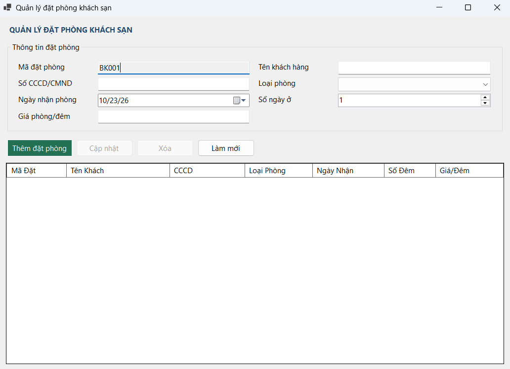
*Mô tả: Giao diện chính hiển thị 

### 2. Ảnh màn hình kết quả
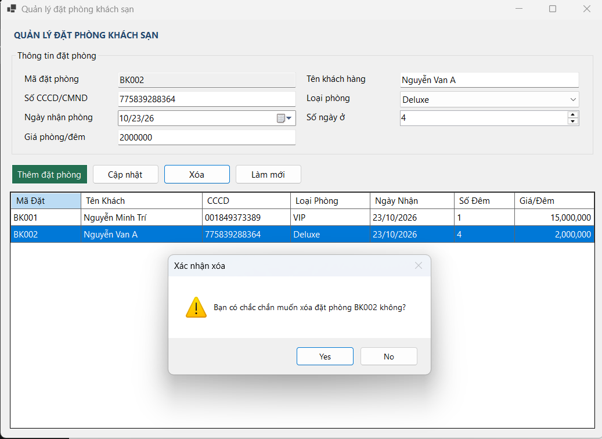
---------
.png)
---------

### 3. Ảnh màn hình Kiểm tra lỗi (Validation)
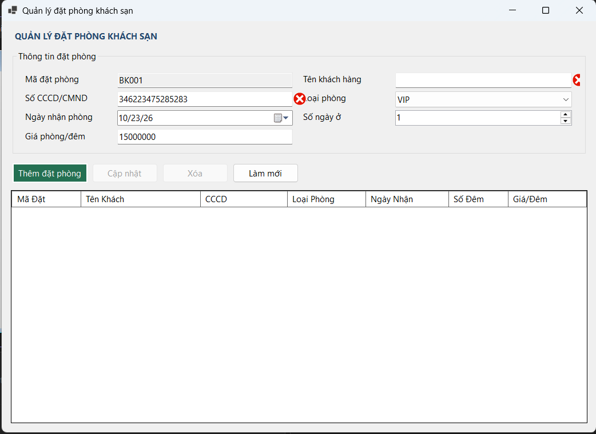

---
### Bài 2: QUẢN LÝ HỒ SƠ NHÂN SỰ & THÔNG TIN LƯƠNG
### 1. Ảnh màn hình Giao diện chính
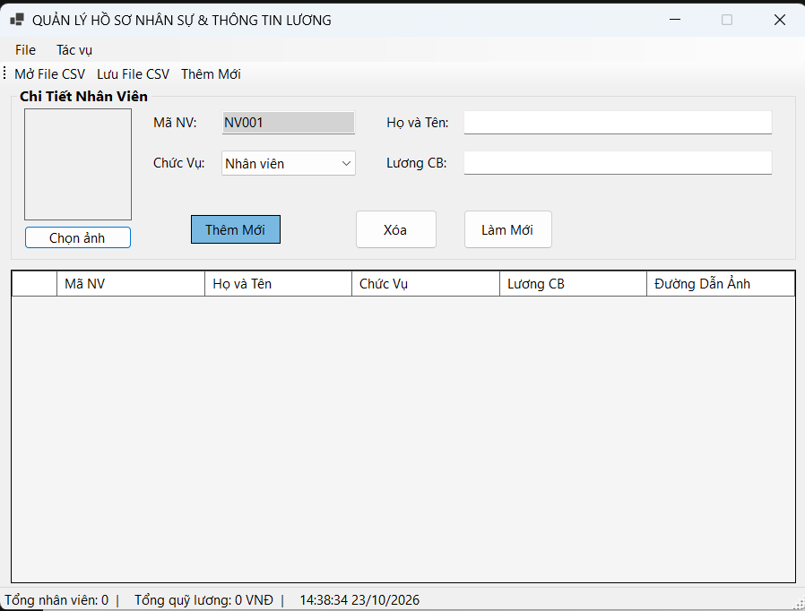

### 2. Ảnh màn hình kết quả
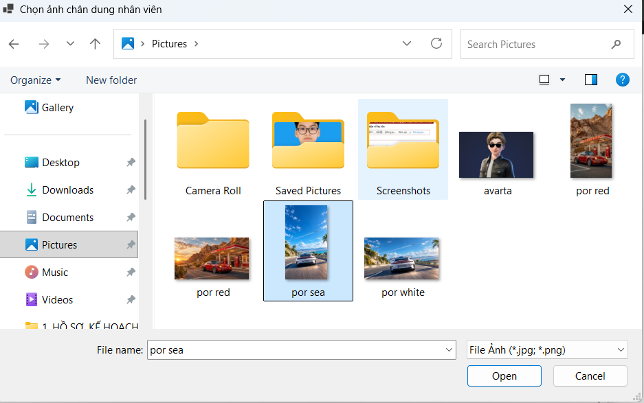
---------
.png)
---------
.png)
---------

### 3. Ảnh màn hình Kiểm tra lỗi (Validation)
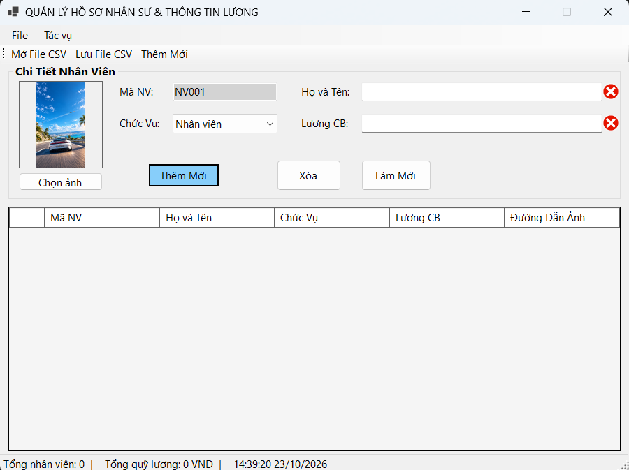
---

### Bài 3: HỆ THỐNG MDI QUẢN LÝ TRƯỜNG HỌC & ĐÀO TẠO
### 1. Ảnh màn hình Giao diện chính
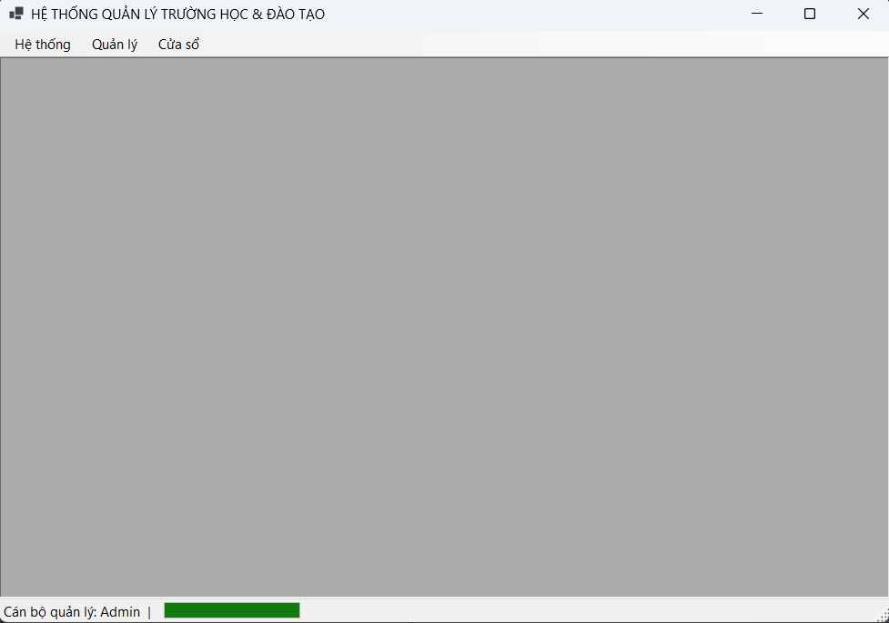

### 2. Ảnh màn hình kết quả
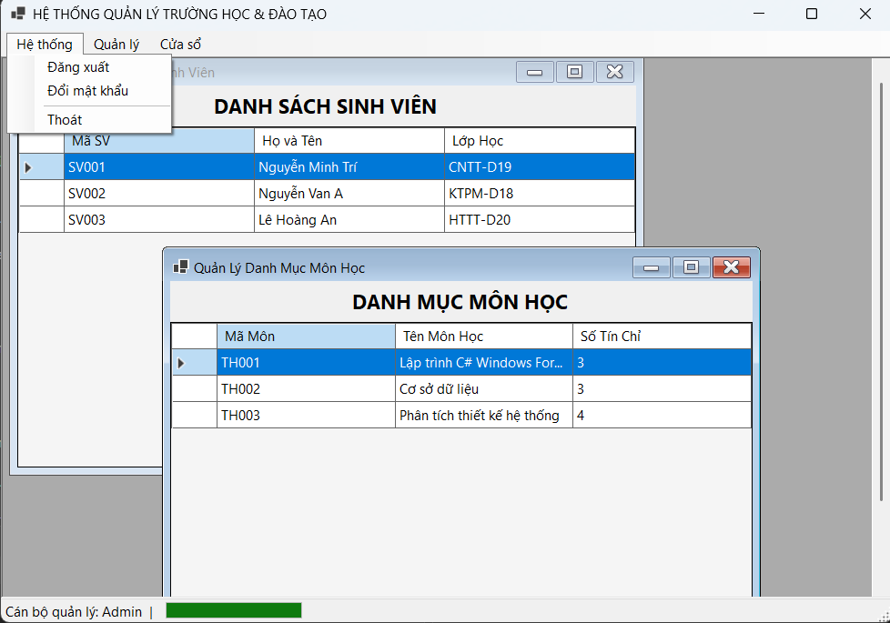
---------
.png)
---------
.png)
---------
.png)
---------
.png)
---------
.png)
---------

### 3. Ảnh màn hình Kiểm tra lỗi (Validation)
*Không có lỗi*

---
### Bài 4: BẢNG ĐIỀU KHIỂN TỔNG HỢP BÁO CÁO KHO HÀNG
### 1. Ảnh màn hình Giao diện chính
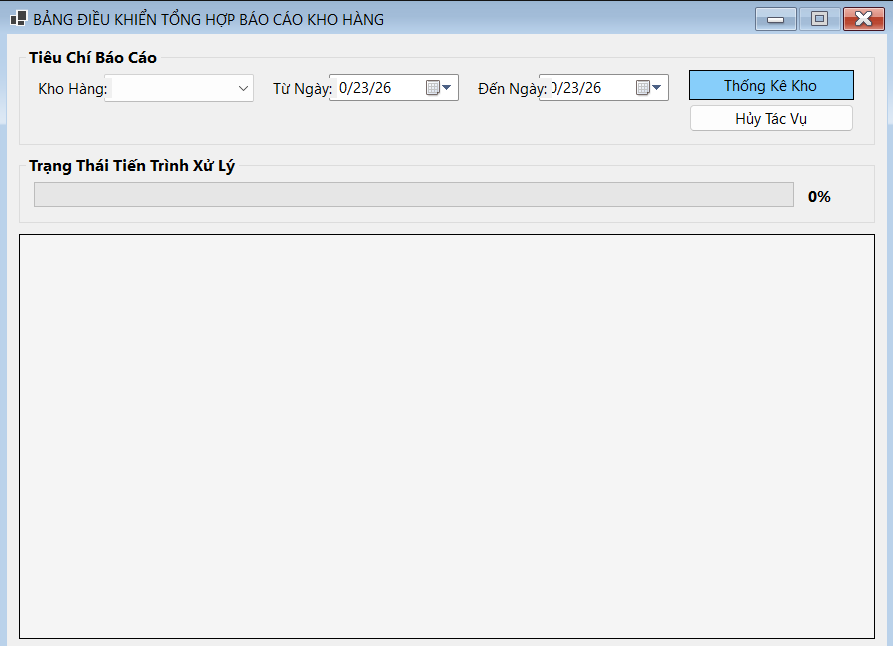

### 2. Ảnh màn hình kết quả
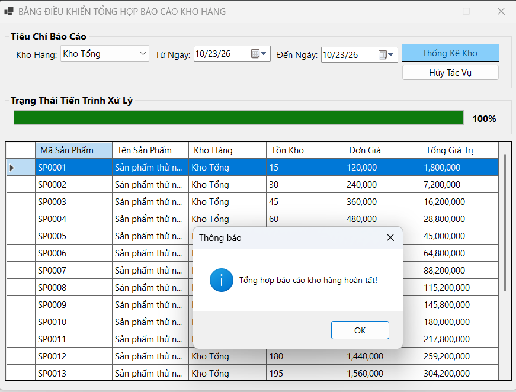
---------
.png)
---------
.png)
---------

### 3. Ảnh màn hình Kiểm tra lỗi (Validation)
*Không có lỗi*

---
### Bài 5: MÔ PHỎNG GIÁM SÁT HỆ THỐNG CẢNH BÁO IOT REAL-TIME
### 1. Ảnh màn hình Giao diện chính
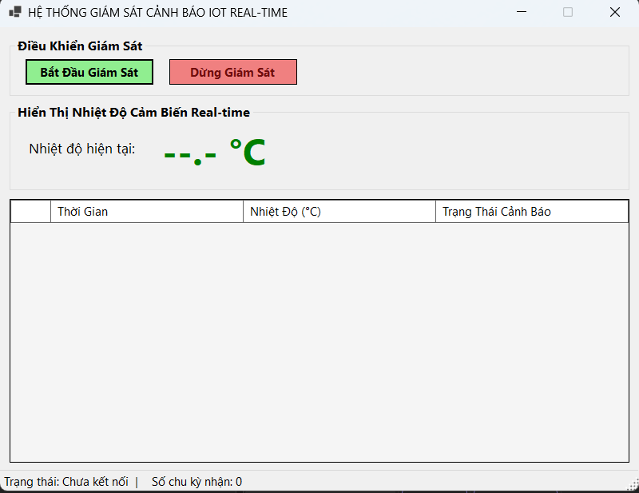

### 2. Ảnh màn hình kết quả
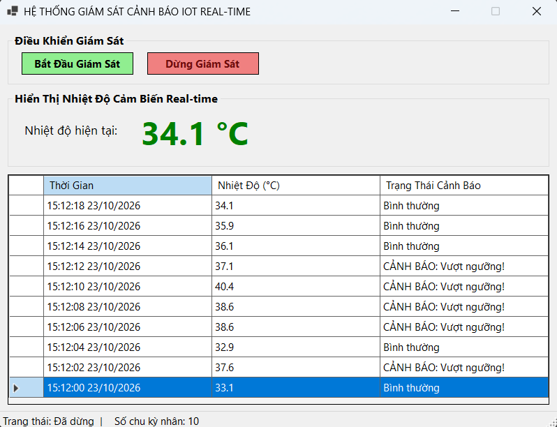
---------

### 3. Ảnh màn hình Kiểm tra lỗi (Validation)
*Không có lỗi*